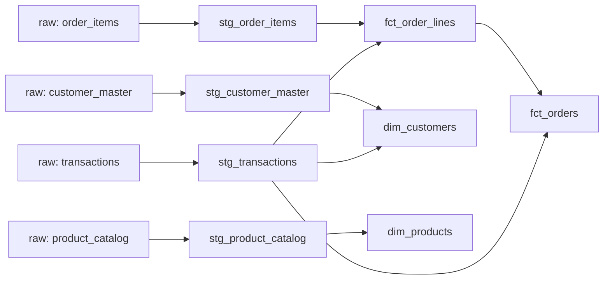

# dbt + Databricks practice project

A learning exercise: building a small analytics warehouse with dbt Core on
Databricks Free Edition, worked from the macOS command line. All data is synthetic.

## What it does

Takes four raw tables (orders, order lines, customers, products) and builds
tested, documented models on top of them.



## Stack

- Databricks Free Edition (SQL warehouse, Unity Catalog)
- dbt Core with the dbt-databricks adapter
- Python virtual environment, Git, VS Code

## Project layout

- `models/staging/`: one view per raw table (typing, renaming, cleaning)
- `models/marts/`: dimension and fact tables
- `tests/`: custom SQL tests

## Modeling decisions

- **Grain:** `fct_order_lines` is one row per order line; `fct_orders` is one row per order, rolled up from the lines.
- **Source of truth:** line-level amounts. Header totals are kept as `header_*` columns with a `totals_reconcile` flag.
- **Profit:** the source profit counts tax as profit, so the marts add `profit_excl_tax` (verified with a test).
- **Currency:** [fill in after running the currency check: amounts treated as a common unit, or converted].

## Known data issues

- About 8% of orders (11,226 of ~138,000) have header totals below their line totals; every order with six or more lines is affected. This is reported as a test warning, not an error.
- The same product can appear twice on one order with different quantities or discounts, so `(order_id, product_id)` is not a key. A hash of all line columns is used as `line_id`.

## Testing

[N] tests: `unique`, `not_null`, and `relationships` checks on keys, plus custom tests for line-to-header reconciliation and the profit definition.

## Running it

```
python3 -m venv .venv && source .venv/bin/activate
pip install "dbt-core<2" dbt-databricks
cd databricks_lab
dbt debug
dbt build
```

Connection details go in `~/.dbt/profiles.yml` (not in this repo).

## Next steps

Incremental models, source freshness checks, and a nightly scheduled run.